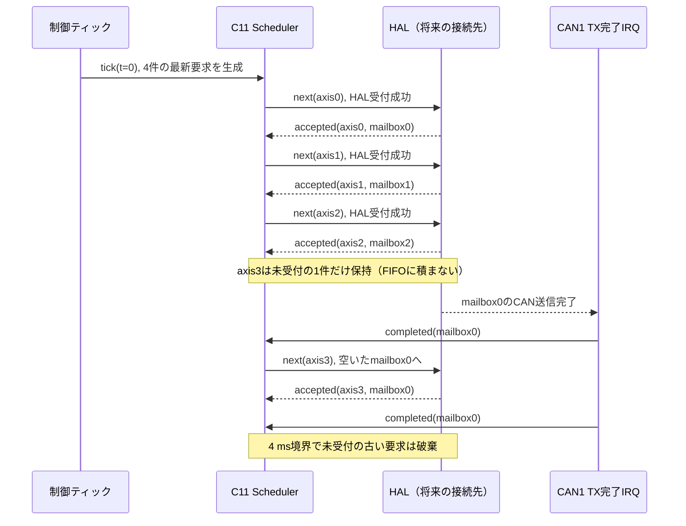

# CAN送信スケジューラ：責務・時系列・保守手順（Issue #5）

**実装範囲：** ホスト実行できるC11の送信要求モデル。HAL、実機CAN、モータ駆動、ARM処理、既存の安全状態機械には接続していない。  
**仕様：** `BOARD-F446-001`、`PROTO-RS06-001`、`PROTO-C620-001`、MOTOR-189〜195。  
**依存：** PR #16 の `firmware/f446/balancing_f446/App` 一元配置に基づく。PR #16 は現時点で未マージ。

## 1. 目的と禁止事項

F446で実行する500 Hz制御ティックを基準に、CAN1のRS06×4へ250 Hz、CAN2のC620共通フレームへ500 Hzの**送信要求**を発行する。CAN送信の受付と完了、各モータの新しい受信報告は**別々の事象**である。外部HALが割り込んでも最新世代のみを扱い、古いトルクをソフトウェアに蓄積しないことを確認する。

実装は `App/Inc/balancing_tx_scheduler.h` と `App/Src/balancing_tx_scheduler.c`。テストは `tests/test_tx_scheduler.c`。このAPIはモータを動かす機能を**持たない**。実際のトルク生成、CAN-ID符号化、HAL割込み接続、ドライバ許可、非常停止の保証を含めない。

## 2. 時系列：何が2 ms / 4 msなのか

| 仮想時刻 | 500 Hz control tick | CAN2 0x200（C620共通） | CAN1 RS06（4台） |
|---|---|---|---|
| 0 ms | 1回目 | 最新値1件要求 | 世代1として4台分要求 |
| 2 ms | 2回目 | 最新値1件要求 | 新規要求なし |
| 4 ms | 3回目 | 最新値1件要求 | 世代2として4台分要求 |
| 6 ms | 4回目 | 最新値1件要求 | 新規要求なし |
| 8 ms | 5回目 | 最新値1件要求 | 世代3として4台分要求 |

この表は**要求時刻**を示し、実バスでの完了時刻や250 Hz達成を保証しない。0 msは起動後最初のモデル制御ティックに相当する。4 ms周期は初回ティックの時刻から位相固定し、遅延しても過去周期の分を「まとめ送り」しない。

### CAN1 3メールボックスで4台を扱う



- **送信要求：** `b_sched_next()` は対象と世代を提示するだけ。HAL BUSYなら `b_sched_accepted()` を呼ばない。
- **受付：** `b_sched_accepted()` は0〜2の実メールボックス占有を記録する。**完了時刻は更新しない**。
- **送信完了：** 対応する `b_sched_completed()` で占有を解除し、その世代が現在でも有効な場合だけ対象軸のTX完了時刻を記録する。
- **新世代：** 4 ms後、古い未受付の要求は破棄。**HALに受け付けられた旧フレームは物理的に取り消したことにならない**。旧世代がメールボックスに残る間は新世代のRS06要求を進めない。旧世代の遅い完了は最新のTX監視時刻として使用しない。
- **CAN2：** 2 ms周期で最新の共通電流要求へ置換。実メールボックス内の旧CAN2指令が完了するまでは次を重ねない。DISARMED/FAULT時は`zero_current=true`。これはまだ**0 A CANフレームではなく抽象的な要求**である。

## 3. 実装の所有権

| データ | 所有者 | 不変条件 |
|---|---|---|
| `rs_pending[4]`、`wheel_pending` | Scheduler | 未受付の最新世代のみ。古い待ち行列を保持しない |
| `rs_generation`、`wheel_generation` | Scheduler | 要求が更新された世代を識別。旧世代のHAL受付は拒否 |
| `mail[2][3]` | Scheduler（HAL模擬） | 送信完了まで占有。バスごとに最大3件 |
| `rs_tx_done_us[4]`、`wheel_tx_done_us` | Scheduler | **送信完了通知時のみ**更新 |
| `rs_rx_us[4]`、`wheel_rx_us[2]` | Scheduler | 有効な**新規**フィードバック時のみ更新 |
| `fault_requested`、`fault_flags` | Scheduler | 検出したFAULT要求をラッチ。自動解除しない |
| DISARMED/BALANCING/FAULT | 既存の`BModeMachine` | **SchedulerはBModeMachineを変更しない** |
| 駆動許可、電流・トルク上限 | 上位Safety／制御／配分器 | Schedulerは設定・ゲート・符号化を行わない |

## 4. FAULT判定：既定値と未確定値を分ける

| 事象 | ホストモデルの処理 | 根拠 |
|---|---|---|
| 500 Hz制御更新の差が**6 ms以上**（駆動許可中） | `B_SCHED_FAULT_CONTROL_GAP` | MOTOR決定、既存状態機械と同条件 |
| 単調時刻の逆行（駆動許可中） | `B_SCHED_FAULT_CLOCK` | 時計の一貫性 |
| RS06一軸の受信鮮度**30 ms以上** | `B_SCHED_FAULT_RS_RX` | `PROTO-RS06-001` |
| C620一軸の受信鮮度**20 ms以上** | `B_SCHED_FAULT_WHEEL_RX` | `PROTO-C620-001` |
| RS06各軸のTX完了が未到達／一定時間停止 | `B_SCHED_FAULT_RS_TX` | 時間閾値は**未決定** |
| C620共通指令のTX完了が未到達／一定時間停止 | `B_SCHED_FAULT_C620_TX` | 時間閾値は**未決定** |
| CANバスオフ通知 | `B_SCHED_FAULT_BUS_OFF` | 安全仕様 |

`BSchedConfig` の `rs_tx_timeout_us` と `c620_tx_timeout_us` は0を拒否する。**ホストテストで使用する9,000 µs / 6,000 µsなどは仮想故障注入専用であり、実機の安全閾値ではない。** 実機バス負荷・CAN競合・HAL callback遅延を確認して、安全担当の承認を受けてから固定する。

FAULT検出時にはRS06の新規送信要求を無効化し、CAN2にゼロ要求を残す。ただしこのコードはHAL送信・RS06 Type4停止要求を生成せず、既にHWに受け付けられた非ゼロ指令を停止できない。**本モデル単独に安全停止を任せてはいけない。** 既存の安全状態機械、物理非常停止、電源系の停止手段を後で接続する必要がある。

## 5. 将来HALに接続するときのレビュー順序

1. `main.c` / `application.cpp` の2 ms TIM7通知を1つの単調増加µs時刻に変換する。**HAL_GetTickのms値をそのまま渡さない**。割込みと制御ループで同じ時間基準・イベント順序を維持する。
2. `b_mode_step()` が出す `drive_allowed` と安全な検証済みパラメータだけを入力する。ARM待機中は`drive_allowed=false`。受信はフレームの新規性を確認してから `b_sched_feedback()` に渡す。
3. `b_sched_next()` の抽象要求を、上位で検証済みの目標トルク/電流と既存codecでCANフレームに変換する。**モデル自身に電流・トルク値を追加しない**。
4. 実HALがメールボックス番号を返した場合に限り `b_sched_accepted()` を呼ぶ。**HAL受付直後にIRQが先行する競合を防ぐため、HAL受付とモデルの記録を原子的にするかIRQ実行順序を制御する**。ここは実機接続時の設計レビュー必須項目。
**設計上の要注意点：** 実際のCAN1はRS06のType1トルクだけでなく、Type3有効化・Type4停止なども使用する。これらの送信が別経路でメールボックスを占有すると、現行モデルの`mail[0][0..2]`管理と実HALの状態が食い違う。**実HAL接続前に、CAN1の全送信フレームを1つの調停者で管理するか、緊急停止を優先できる明示的な占有・キャンセル手順を設計すること。** 未完了Type1が残っているとき、単にソフトウェアの要求を破棄してもType4が先に届く保証はない。

5. HAL CAN TX mailbox0/1/2 complete callbackから `b_sched_completed()` に実メールボックス番号と同じ単調時刻を渡す。Tx abort/error/Bus-offやCANバス占有の実挙動を別途設計する。
6. `fault_requested` は上位Safetyへ伝播して`BModeMachine`のFAULT要求へ結合する（**現段階では未接続**）。独立した物理非常停止を維持する。
7. 実機のロジックアナライザ/CANログで、各軸の**要求／HAL受付／実送信完了／新規受信**の時間差、CAN1 3メールボックス滞留、CAN2 0 A周期、Bus-off時の停止手段を計測する。

## 6. 再現テスト

```sh
python3 tools/run_host_tests.py
cmake -S . -B build/host-cmake
cmake --build build/host-cmake
ctest --test-dir build/host-cmake --output-on-failure
```

`tests/test_tx_scheduler.c` が検証する点：2/4 ms要求時刻、3枠と4件目、次世代への古い要求の引き継ぎ禁止、CAN2単一in-flight、受信正常時のTX完了欠落、RS06各軸TX監視、20/30 ms受信断、6 ms停止、時刻逆行、通常DISARM、FAULTラッチ、Bus-off。

ログのPASSは**仮想時計・模擬メールボックスでの論理挙動のみ**。CubeIDEによる更新後のARMクロスビルド、実バスでの期限、割込みレース、MCU CPU負荷、物理停止能力、実機の安全な出力はまだ未検証。

## 7. 設計判断：Aで確定（2026-11-09）

**ユーザー回答：「Issue #5の送信完了タイムアウトはA（実測後に決定）で進めて。ホスト検証を継続して。」**

- **決定事項：** RS06各軸/C620共通フレームのTX完了監視閾値を実測前には固定しない。両者を`BSchedConfig`の異なる引数として維持する。
- **理由：** 1 MbpsのCAN負荷、3メールボックス占有、HAL割込み遅延、Txが実際に完了するまでの分布が未計測だから。暫定時間を安全値として固定すると正常な遅延をFAULT扱いしたり、逆に実際の異常を見逃したりする。
- **実装上の拘束：** 未設定値0は`b_sched_init`が拒否する。ホストの`4,000/8,000/9,000/6,000 µs`はテストケースの故障注入にしか使わず、CubeIDE運転用の既定値として導入しない。
- **今後の決定手順：** CAN1各軸とCAN2共通の要求／受付／送信完了／受信を同一時計で記録し、バス負荷・割込みジッタ・最悪実行時間を評価。停止できる独立経路を確認したうえで別途閾値を承認する。
- **未決定：** 実機値そのもの。これは「Aで確定」と矛盾しない。

## 8. 敵対的レビューで見つかった競合と防止策

### A. `next()` と `accepted()` で受付条件を共有する

当初は`next()`で古いメールボックスをチェックしていたが、呼び出し側が保持したIntentを直接`accepted()`へ渡すと、条件を迂回できた。C620も同様に別メールボックスへ同じバスの新旧要求を重ねられた。

**修正：** 共通の`rs_previous_generation_inflight()`/`wheel_inflight()`を使用し、`next()`と`accepted()`の両方が同じ条件を検査する。HALに接続するときには**このチェックだけではIRQ競合は解消しない**ため、受付と記録の区間を割込み制御などで直列化する。すでに物理的に受理したフレームを`accepted()`が拒否した場合、無追跡の送信が残るのでそのまま運転してはならない。

### B. DISARMを跨いだ完了通知を新しいARMに流用しない

```text
0.0 ms  ARM中、旧世代gのRS06 Type1をHALが受理
2.0 ms  DISARM。未受付要求を破棄し、RS世代をg+1へ進める
3.0 ms  再ARM（試験用の不規則な時刻）
3.5 ms  旧世代gのTx完了通知が到達
        → 旧世代として数え、再ARM後の送信完了鮮度を更新しない
```

**修正：** 駆動許可の立下がり時に`rs_generation`を進める。送信完了は現在の世代と一致し、駆動許可中でFAULTではない場合だけ鮮度を更新する。これは**実ハードの旧送信を取り消す機能ではない**。

### C. 同一時刻の重複制御ティックは冪等。ただしDISARMを最優先する

元のモデルでは`b_sched_tick(t)`を同じ`t`で2回呼ぶと、C620要求の世代が2回進んでいた。**同一時刻・同一の駆動許可状態なら二重処理を避ける**。

ただし、最初に作った重複無視の実装では、`tick(t, true)`直後に`tick(t, false)`と呼ぶと**同時刻DISARMまで無視する欠陥**が見つかった。現在は次の動作をテストで固定する。

| 同一タイムスタンプでの2回目の入力 | 期待する処理 |
|---|---|
| 駆動許可が変わらない | 新しい指令世代を生成しない |
| `true → false`（DISARM） | **直ちに**RS06待ち要求を無効化し、CAN2ゼロ要求へ置換 |
| `false → true`（再ARM） | 同時刻では受け付けず、次の正式ティックまで保留 |

この挙動はホストモデル内の安全優先順位であり、HALに送信済みの旧フレームを物理的に止められることや割込みジッタの保証を意味しない。

### D. 監視閾値の注入検証

RS06/C620の設定値を異なる値へ切り替え、期限の直前ではFAULTにせず、**設定した期限ちょうど**で対応するTX異常を検出する試験を実行する。RX鮮度が維持されていてもTX異常を独立に検出する。テスト用の数値を実機仕様の既定値に昇格させない。

CAN2は2 msごとに最新世代を作るが、旧世代のHAL受理済みフレームが2 msを超えてから送信完了する場合もある。**旧世代のTx完了は最新の送信完了鮮度へ計上しない**。そのため、実測前にTX完了タイムアウトを固定すると誤FAULTのリスクがある。現実のCAN2遅延分布と制御系の締切を測る必要がある。
