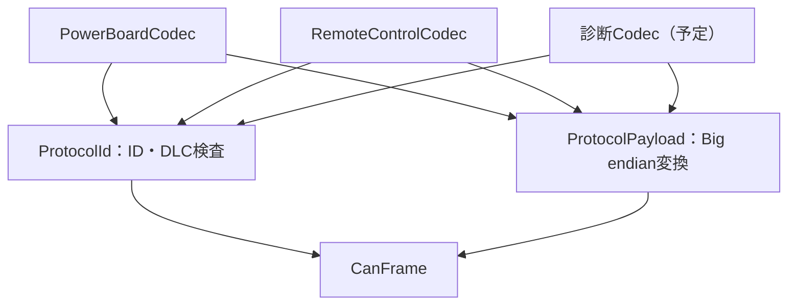

# 図で見る制御システム

**設計図更新** 2026-11-17（F446 C++17公開API、MOTOR-151／197／198）

F446の設計上の呼び出し順と通信の流れを示します。現行C11の比較基準は図6にあります。各APIの型と責務は [F446 公開API設計](design/public-api.md) を参照してください。

## 図の目次

| 知りたいこと | 図 |
|---|---|
| 入力からモータ指令まで | 1. 全体データフロー |
| ARMと送信完了・応答の関係 | 2. ARM要求から倒立開始 |
| 演算と送信の周期 | 3. 倒立中の周期処理 |
| DISARMED・ARMING・BALANCING・FAULT | 4. 状態遷移 |
| 異常停止と電源遮断 | 5. 非常停止 |
| 移行時の比較基準 | 6. 旧C11制御コアと周辺 |
| 後続のジャンプ | 7. ジャンプ状態機械 |
| 異常情報のPCへの配信 | 8. CAN診断 |

通信ID・電気的な条件は [CAN総覧](can-id-table.md) と [F446](specs/boards/f446_control.md)・[F303](specs/boards/f303_power.md) の仕様書、状態遷移の条件は [動作仕様](specs/behavior/robot_operation.md) を参照してください。

## 1. 全体データフロー

<pre class="mermaid">
flowchart TB
    IO["IMU・操作・電源"] --> APP["Application：周期入力を固定"]
    APP --> EST["StateEstimator"]
    EST --> KIN["LegKinematics：左右各脚"]
    KIN -->|脚の解| EST
    EST -->|ControlSnapshot| CTRL["BalanceControl"]
    EST -->|推定結果または理由| SEQ["RobotSequence"]
    APP -->|操作と機器の安全状態| SEQ
    APP -->|BalanceReference| CTRL
    SEQ -->|駆動の許可| CTRL
    CTRL -->|MechanismTorques| CMD["MotorCommand"]
    CMD -->|MotorTargetsまたは失敗| OUT["Application：6軸の最終指令"]
    CMD -.->|変換異常| SEQ
    SEQ -->|DesiredMotorState・ARMセッション番号| OUT
    OUT --> MS["MotorService"]
    MS -->|指令| RS["CAN1：RS06 4軸"]
    MS -->|指令| WHEEL["CAN2：C620 2軸"]
    RS -->|状態報告| MS
    WHEEL -->|車輪報告| MS
    MS -->|MotorFeedbackSnapshot| APP
</pre>

`ControlSnapshot` は機体・車体・脚・車輪の変換済み物理状態を持つ。駆動が許可された周期だけトルクを計算する。通常の指令飽和は `MotorCommand` が記録し、停止を要する異常は送信前に `RobotSequence` へ伝える。

## 2. ARM要求から倒立開始まで

<pre class="mermaid">
sequenceDiagram
    participant APP as Application
    participant SEQ as RobotSequence
    participant MS as MotorService
    participant CAN as CAN1
    participant RS as RS06 4軸

    APP->>SEQ: 明示ARM要求と事前条件
    alt 事前条件成立
        SEQ->>SEQ: ARMING、セッション番号と全体期限を固定
        SEQ-->>APP: 有効化要求、非ゼロ駆動禁止
        APP->>MS: 有効化要求とARMセッション番号
        loop ARMING中は各周期で確認
            opt 未受付の軸は絶対期限内で再試行
                MS->>CAN: Type 3送信要求
                CAN-->>MS: HAL受付結果
            end
            opt 実際に送信が完了した軸
                CAN->>RS: Type 3送信
                CAN-->>MS: 軸別Type 3のTx完了
            end
            opt その軸の新規状態報告
                RS-->>CAN: 状態報告
                CAN-->>MS: 受信フレームと時刻
                MS->>MS: Tx完了より後の正常応答を確認
            end
            MS-->>APP: 軸別の有効化結果と異常
            APP->>SEQ: 今周期の安全状態
        end
        alt 期限前に4軸確認、必須条件成立
            SEQ-->>APP: BALANCING
            APP->>APP: 現在の脚長を基準に制御器初期化
        else 期限到達・確定故障・必須条件消失
            SEQ-->>APP: FAULT、全軸停止要求
            APP->>MS: 非ゼロ指令を無効化し停止要求
        else 異常のない手動DISARM
            SEQ-->>APP: DISARMED、全軸停止要求
            APP->>MS: 非ゼロ指令を無効化し停止要求
        end
    else 事前条件不成立
        SEQ-->>APP: DISARMED、拒否理由
    end
</pre>

初期姿勢・脚長の指定範囲外は診断に用いる。機構安全条件は別に確認し、未検証・不成立の場合は非ゼロ駆動を禁止する（MOTOR-151）。ARM全体の絶対期限を検証済み設定から与える。確定故障・必須条件消失・期限到達は、同周期のDISARMや成功より優先する。詳しい境界条件は [動作仕様](specs/behavior/robot_operation.md) を参照。

### RS06 1軸の停止送信

<pre class="mermaid">
sequenceDiagram
    participant MS as MotorService
    participant AX as Rs06Motor
    participant CAN as CAN1送信ポート
    MS->>AX: StopAllを反映
    opt 同じ軸のType 3が受付済み
        CAN-->>AX: 旧トークンのTx完了または送信中止
        Note over MS,CAN: 他軸の停止送信は先に進められる
    end
    AX-->>MS: Type 4の送信候補
    MS->>CAN: Type 4を送信要求
    alt メールボックス満杯・再試行可能な失敗
        CAN-->>AX: 停止未完了、送信可能になったら再試行
    else Type 4のTx完了
        CAN-->>AX: 停止の送信完了
        opt その後に正常なリセットモードを受信
            CAN-->>AX: モータの無効化を確認
        end
    end
</pre>

この送受信順序と軸ごとの再試行は[RS06 4軸の模擬CAN試験](verification/motor-service-rs06-host.md)で検証する。実CANへの接続では、メールボックスの解放・キャンセル完了とトークンを一致させ、各受信を同じ単調時計で記録する。

共通 `CanPort` の2バス独立性と、RS06とのホスト試験での呼び出し順は [共通CANポートとRS06のホスト検証](verification/f446-can1-rs06-port-host.md) に示す。

基板側のCAN1初期化から割込み取得までの順序は [CAN1の起動・割込みの検証](verification/f446-can1-runtime-host.md) を参照。

メイン処理でのイベント回収順、1バス当たりの上限と配信先は [CANイベント回収・配送の検証](verification/f446-can-event-dispatch-host.md) を参照。

## 3. 500 Hz制御周期の処理

<pre class="mermaid">
sequenceDiagram
    participant IRQ as タイマーIRQ
    participant APP as Application
    participant SE as StateEstimator
    participant RS as RobotSequence
    participant MS as MotorService

    IRQ-->>APP: 2 msごとの実行要求
    loop メインループで周期実行
        MS-->>APP: 6軸分のMotorFeedbackSnapshotと安全状態
        APP->>APP: IMU・操作を含めて入力を固定
        APP->>SE: update(input, elapsed)
        SE-->>APP: ControlSnapshotまたはStateEstimateError
        APP->>RS: 推定結果、操作、機器の安全状態
        RS-->>APP: DesiredMotorStateとARMセッション番号
        opt 駆動が許可され制御入力が成立
            APP->>APP: BalanceControlからMotorCommandへ
            opt 停止を要する計算・変換異常
                APP->>RS: 異常を反映して最終の要求を得る
            end
        end
        alt 非ゼロ駆動を許可
            APP->>APP: 今周期の6軸MotorTargetsを採用
        else 非ゼロ駆動を禁止
            APP->>APP: 状態に応じてゼロ電流・停止・有効化要求を確定
        end
        APP->>MS: DesiredMotorState・ARMセッション番号・6軸指令
        opt 非ゼロ駆動を禁止
            MS->>MS: 保持中・送信待ちの非ゼロ指令を無効化
        end
        MS->>MS: CANごとに送信調停
    end
</pre>

| 対象 | 通常送信 |
|---|---|
| RS06 | 250 Hz（4 ms）で4軸に最新のType 1を送信要求。CAN1の3メールボックスに順次投入 |
| C620 | 500 Hz（2 ms）で左右の電流をCAN2の1フレーム（0x200）に格納 |
| RS06の停止 | 各軸のType 4を優先し、軸別のTx完了まで未完了として追跡 |

受信の更新時刻とCAN送信完了時刻は別に監視する。入力のサンプル時刻と、推定に渡す実測周期間隔も区別する。停止へ切り替えるときは、停止要求を対象別に保持し、ソフトウェアで待っていた周期フレームを破棄する。受付済みフレームは元のトークンで送信終端を回収する。[停止送信のシーケンスと検証](verification/f446-can-event-dispatch-host.md)を参照。

## 4. ロボットの状態遷移

<pre class="mermaid">
stateDiagram-v2
    [*] --> DISARMED: 起動後
    DISARMED --> ARMING: 明示ARMを受理
    ARMING --> BALANCING: 期限前にRS06全4軸を確認
    ARMING --> DISARMED: 異常のない手動DISARM
    ARMING --> FAULT: 非常停止・期限到達・確定故障・必須条件消失
    BALANCING --> DISARMED: 手動DISARM
    BALANCING --> FAULT: 重大保護条件・非常停止
    DISARMED --> FAULT: CAN非常停止
    FAULT --> DISARMED: 原因解消と明示CLEAR_FAULT
    note right of ARMING
      Type 3のTx完了と
      その後の正常応答を全軸で待つ
      非ゼロ指令は禁止
    end note
    note right of FAULT
      駆動禁止と全軸停止要求
      主原因・発生時と継続中の異常を記録
    end note
</pre>

復旧には原因解消、明示CLEAR_FAULT、別のARM要求が必要。停止要求が残っている場合はARMを受理しない。独立した物理非常停止は最優先で電源を遮断する。電源断後のFAULT保持はMOTOR-095として保留。

## 5. 非常停止と電源遮断

<pre class="mermaid">
sequenceDiagram
    autonumber
    participant EXT as 外部CANの非常停止
    participant F446 as F446主制御
    participant F303 as F303電源
    participant MOT as RS06・C620

    Note over EXT,F303: 物理非常停止は別経路で最優先
    par 主制御側
        EXT->>F446: EMERGENCY_STOP（拡張ID）
        F446->>F446: FAULTへ遷移しトルク出力を停止
    and 電源基板側
        EXT->>F303: EMERGENCY_STOP（拡張ID）
        F303->>F303: 主電源OFFをラッチ
    end
    Note over F446,MOT: 電源が先に切れる可能性があり停止指令の到達を保証しない
    Note over F446,F303: 復旧の基本順序：POWER_ON → CLEAR_FAULT → ARM
</pre>

**注意：** CAN非常停止に加え、物理非常停止は制御ソフトと独立した遮断手段とする。フレーム番号は[電源CAN仕様](specs/protocols/power_can2.md)と[上位CAN仕様](specs/protocols/remote_can2.md)を参照。CAN IDの送信元は認証ではない。

## 6. 移行時の比較基準：旧C11制御コアと周辺アダプタ

<pre class="mermaid">
flowchart LR
    USB["操作入力と制御イベント"] --> AD["ハードウェア依存アダプタ（未実装）"]
    CAN["CAN／I2Cの受信値"] --> AD
    CLOCK["単調増加クロック"] --> AD
    AD --> F["更新鮮度の判定"]
    AD --> M["DISARMED・BALANCING・FAULTの遷移"]
    AD --> L["変化率制限と6状態LQR"]
    F --> M
    L --> W["倒立優先の左右トルク配分"]
    M --> G{"駆動許可と停止要求"}
    W --> G
    G --> OUTPUT["CAN送信アダプタ（未実装）"]
    subgraph CORE["ホストで検証する純粋なC11コア"]
        F
        M
        L
        W
        G
    end
</pre>

旧C11の比較基準。ARM待機はDISARMED内で管理する。アダプタ統合と実機用LQRゲインの検証は未完了。詳細は[制御コア設計](software-core.md)。

## 7. 後続開発：ジャンプの1つの状態機械

<pre class="mermaid">
stateDiagram-v2
    [*] --> PREPARE: 静止・両輪接地で押下イベント
    PREPARE --> TAKEOFF: 離陸準備完了
    TAKEOFF --> FLIGHT: 離陸を検出
    TAKEOFF --> RECOVERY: 離陸不成立で接地安定
    FLIGHT --> LANDING: 左右どちらかが接地
    LANDING --> RECOVERY: 両輪接地が安定
    RECOVERY --> [*]: 通常BALANCINGへ
    note right of TAKEOFF
      左右に同じ一定目標推力
      ガスシリンダ補償と個別トルク制限
    end note
    note right of LANDING
      接地した側：柔らかい脚長PD
      未接地側：空中用脚長PD
      機体全体の状態は1つ
    end note
</pre>

**後続の仕様のみ：** ジャンプはMOTOR-213の初期実装対象外。どの状態でも非常停止、DISARM、重大FAULTを優先する。離陸・着地誤判定とタイムアウトは[ジャンプ仕様](specs/behavior/jump.md)と[TODO](todo/jump.md)を参照。

## 8. 異常イベントと定期ステータスのPC配信

<pre class="mermaid">
flowchart TB
    FAULT["RobotSequence：FAULT記録"] --> EVENT["DiagnosticsService：イベント"]
    STATUS["システム状態"] --> LAST["最新の定期ステータス"]
    EVENT --> IMPORTANT["重要イベントFIFO"]
    EVENT --> NORMAL["通常イベントFIFO"]
    IMPORTANT --> TX["CanTxScheduler"]
    NORMAL --> TX
    LAST --> TX
    TX --> BUS["CanPort：固定CAN IDで送信"]
    BUS --> PC["PC：異常とステータスを表示"]
    BUS -->|各フレームのTx完了| TX
    TX -->|イベントの送信進捗| EVENT
</pre>

`FaultEvent` は3フレームで、32 bitのミリ秒時刻を持つ。各フレームのTx完了を個別に追跡し、イベントは全フレーム完了まで保持する。IDの値・バス割当て等は[公開API設計](design/public-api.md)の確定待ち項目を参照。

## 図の管理

図はMermaid記法で編集できる。Doxygen 1.9.8ではMermaid記法の自動描画に対応していないため、`pre class="mermaid"`を用い、生成されたHTML上で**VM内のMermaid.js**により図に変換する。インターネット接続は不要。紙媒体向けのSVG・PNG書き出しは別途実施する。

文書中の未確定事項は図でも確定事項として表現しない。変更時には対応する仕様書と図を同じ作業内で更新する。

## CAN2車輪観測から相対位置・速度へのC++17変換

<pre class="mermaid">
flowchart TB
    CAN["CAN2：C620左右報告"] --> LINK["MotorCanLink：CANイベント配送"]
    LINK --> SERVICE["MotorService：C620生値・受信時刻・鮮度"]
    SERVICE --> ODOM["WheelOdometry：累積カウントを距離へ換算"]
    ODOM --> EST["車輪観測：位置 m・周速度 m/s"]
    SERVICE -.->|"freshを再利用"| EST
</pre>

位置の積算はC620Motorが受信ごとに一度だけ行い、WheelOdometryは物理換算のみを担当します。20 msの鮮度判定は `MotorService` に残し、旧C11と新C++17の期限境界差分は [ホスト検証記録](verification/f446-wheel-odometry-host.md) に明記します。実CAN2と実機駆動は未検証です。

## IMUと6軸の同一周期StateEstimator

<pre class="mermaid">
flowchart LR
    IMU["BNO055姿勢フィルタ：新規IMU時刻"] --> EST["StateEstimator：同一周期で評価"]
    CAN1["CAN1 RS06：脚4軸・個別受信時刻"] --> M["MotorService：6軸コピー"]
    CAN2["CAN2 C620：左右車輪・個別受信時刻"] --> M
    M --> LEG["LegKinematics：左右脚・解析J"]
    M --> WHEEL["WheelOdometry：左右位置・速度"]
    LEG --> EST
    WHEEL --> EST
    EST --> OUT{"全入力が成立したか"}
    OUT -->|Yes| SNAP["ControlSnapshot：Body Chassis Leg Wheel"]
    OUT -->|No| ERR["StateEstimateError：制御入力不成立"]
</pre>

脚はCAD未検証の数学fixtureのみであるため、ControlSnapshotの有無は実機の駆動許可を意味しません。古い姿勢・各軸時刻は500 Hzのコピー時刻で更新しません。

## 固定脚長の500 Hz SIL制御経路（実機駆動なし）

<pre class="mermaid">
flowchart TB
    OBS["IMU / CAN1脚4軸 / CAN2車輪2軸"] --> FIX["StateEstimator：1周期のControlSnapshot"]
    FIX --> SEQ["RobotSequence：ARM/FAULTと駆動要求"]
    FIX --> CTRL["BalanceControl：LQR・脚長Roll PD・VMC"]
    SEQ -.->|"仮想BALANCING時のみ計算結果を採用"| CTRL
    CTRL --> YAW["車輪倒立優先・Yaw PI残余配分"]
    YAW --> MATH["fixtureOnly：関節4軸＋車輪2軸の数学トルク"]
    FIX -->|"未成立"| FAULT["観測不成立 → SILの停止・FAULT"]
    SEQ -->|"FAULT / DISARM"| FAULT
</pre>

この経路は `App/ControlCycle` に本体化し、実測時刻を外部入力とする。実機Application/CAN送信には接続せず、数値fixtureから計算したトルクを実モータへ送らない。500 Hzは仮想時計の2 ms周期であり、MCU上の周期実測ではない。

## 6軸MotorCommandの換算プレビュー（SILのみ）

<pre class="mermaid">
flowchart LR
    S["StateEstimator：状態と時刻"] --> B["BalanceControl：LQR / VMC / Yaw PI"]
    B --> M["MotorCommand：起動時固定の軸別設定"]
    M --> RS["RS06 4軸：機構Nm → モータNm"]
    M --> C["C620 2軸：車輪Nm → 電流A"]
    RS --> P["MotorCommandPreview：軸別要求・適用値・飽和"]
    C --> P
    M -->|"未検証・変換失敗"| F["数学値の棄却→SIL同周期FAULT"]
</pre>

プレビュー結果の `fixtureOnly=true` は固定。CAN/HALへ送る端子はなく、`Application::controlTick()` と実モータの出力は依然として未接続。実機校正と安全審査後の別の実装判断が必要。

## CAN1 Type1とCAN2共通0x200のSILフレーム計画

<pre class="mermaid">
flowchart TB
    SEQ["RobotSequence：周期の駆動要求"] --> PLAN["MotorFramePlan：状態別符号化（SIL）"]
    CMD["MotorCommand：6軸換算・最終制限"] --> PLAN
    PLAN -->|"Balancing + DriveAllowed"| RS["CAN1 Type1 ×4（250Hzの対象）"]
    PLAN -->|"Balancing + DriveAllowed"| C["CAN2 0x200 ×1（500Hzの対象）"]
    PLAN -->|"DISARM/ARMING/FAULT"| Z["CAN2 0x200ゼロ電流のみ"]
    SEQ --> STOP["MotorCanLink：Type4停止は専用枠で管理"]
    STOP -.->|"停止優先"| SCH["CanTxScheduler：旧未受付の周期指令を破棄"]
    RS -.->|"ホスト模擬に限る"| SCH
    C -.->|"ホスト模擬に限る"| SCH
</pre>

MotorFramePlanは実機CANへ接続されていない。CANメッセージ形式の一致は機体安全性・トルク限界・実送信成功の証明ではない。

## ControlCycle本体の処理順と実機未接続の境界

<pre class="mermaid">
flowchart TB
    CLOCK["上位の実測単調時刻・経過時間"] --> INPUT["ControlTickInput：IMUとCAN6軸の固定観測"]
    INPUT --> EST["StateEstimator：現在周期の成立/欠損"]
    EST --> SEQ["RobotSequence：ARM/FAULTを1回決定"]
    EST --> CTRL["BalanceControl：成立時のみ数学トルク"]
    CTRL --> CMD["MotorCommand：最終軸別数学換算"]
    SEQ -->|"StopAll"| STOP["トルク候補破棄、Yaw履歴reset"]
    CMD --> PREVIEW["ControlTickResult：fixtureOnlyプレビュー"]
    SEQ -.->|"DriveAllowedの場合のみ"| PREVIEW
    PREVIEW -.-> LIMIT["Application::controlTickは現時点で未接続"]
</pre>

Core/Driversの生成部分や実CAN送信は変更しない。SILで運転可能な人工値は実機の校正/物理安全許可に昇格しない。

## CAN1受信時計を使うApplication周期診断

<pre class="mermaid">
flowchart LR
    ISR["TIM7 ISR：実行要求"] --> MAIN["main：要求を消費"]
    MAIN --> RX["CAN1イベント回収"]
    DWT["既存DWT単調時計"] --> RX
    RX --> OBS["回収後の評価時刻付き監視コピー"]
    DWT --> OBS
    OBS --> APP["Application：周期差分・時刻診断"]
    APP --> DIAG["読み取り専用TimingSnapshot"]
</pre>

実機ControlCycle・CAN2・IMUとモータ送信にはまだ接続しない。

## CAN1/2共通受信ランタイム

<pre class="mermaid">
flowchart TB
    I1["CAN1 IRQ"] --> P1["CAN1 CanPort：独立キュー"]
    I2["CAN2 IRQ"] --> P2["CAN2 CanPort：独立キュー"]
    DWT["共有DWT時計"] --> I1
    DWT --> I2
    P1 --> POLL["CanEventPoll：交互回収"]
    P2 --> POLL
    POLL --> R["CanRouter：分類"]
    R --> S1["CAN1監視コピー"]
    R --> S2["CAN2監視コピー"]
    DWT --> S1
    DWT --> S2
    S1 --> APP["Application：周期診断"]
</pre>

共通service回収後の評価時刻は両コピーで同じ。機器への配送・ARM・指令送信は未接続。

## C620の受信順積算と連続性

<pre class="mermaid">
flowchart LR
    FIFO["CAN2 FIFO"] --> ROUTE["CanRouter / MotorCanLink"]
    ROUTE --> MOTOR["MotorService / C620Motor：受信順累積"]
    MOTOR --> SNAP["周期コピー：原値・受理番号・原点世代・累積"]
    SNAP --> ODOM["WheelOdometry：距離・RPM速度"]
    ODOM --> EST["StateEstimator"]
    LOSS["RxLost / BusOff / 不正報告"] --> MOTOR
    MOTOR -.->|"連続性喪失"| INVALID["位置無効：正常報告だけで復旧しない"]
</pre>

通信鮮度と位置連続性は別。原点再設定と推定器のresetは上位の明示操作で同期する。実CANランタイムへの配送は未接続。

## CANランタイムから6軸観測へ

<pre class="mermaid">
flowchart LR
    CAN["CAN1/2 CanPort"] --> R["CanRouter"]
    R --> L["MotorCanLink"]
    L --> M["MotorService"]
    M --> S["MotorObservationSnapshot"]
    R --> D["既存受信監視"]
    S --> APP["Application（後続）"]
</pre>

観測のみ。送信経路は未接続。

## BNO055入力

<pre class="mermaid">
flowchart LR
    IRQ["I2C1 IRQ：完了通知"] --> P["I2cPort"]
    P --> B["Bno055：設定・DRDY・SI値"]
    B --> F["ImuAttitudeSource：静止校正・相補フィルタ"]
    F --> A["ImuAttitude：元時刻・50ms鮮度"]
    A --> APP["Application（後続）"]
</pre>

未検証の取得条件・静止証明では姿勢無効。

## Applicationの観測周期（非駆動）

<pre class="mermaid">
flowchart TD
    CAN["CAN1/2：MotorObservationSnapshot"] --> APP["Application：共通周期時刻"]
    IMU["ImuAttitude：元時刻・鮮度"] --> APP
    APP --> CYCLE["ControlCycle"]
    CYCLE --> EST["StateEstimator"]
    EST --> SEQ["RobotSequence / BalanceControl"]
    SEQ --> OUT["ApplicationObservation：診断のみ"]
    SEQ -.人工値のSILのみ.-> PLAN["MotorCommand / MotorFramePlan"]
    PLAN -.模擬送信のみ.-> TX["CanTxScheduler"]
</pre>

本番の送信・操作・電源・校正接続は未実施。SILの出力を実機送信に転用しない。

## 電源・操作・診断・表示の論理統合

<pre class="mermaid">
flowchart TD
    P["PowerBoardService：論理電源観測"] --> APP["Application"]
    R["RemoteControlService：操作目標"] --> APP
    APP --> C["ControlCycle / RobotSequence"]
    C --> D["DiagnosticsService：最新状態・独立FIFO"]
    C --> S["StatusIndicator：論理表示"]
    D -.-> PC["Raspberry Pi：CAN2配信未接続"]
    S -.GPIO設定未確認.-> L["LED / Buzzer"]
</pre>

実CAN・USB復号、診断配信と物理GPIOは未接続。

## CAN2 v1共通コーデック

共通処理・電源・操作Codecは実装済み。診断CodecとCAN2送受信への接続は未実施。
